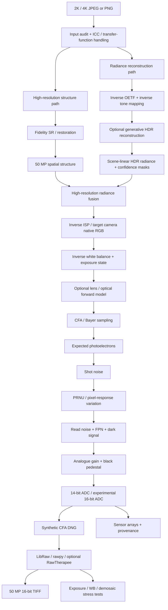
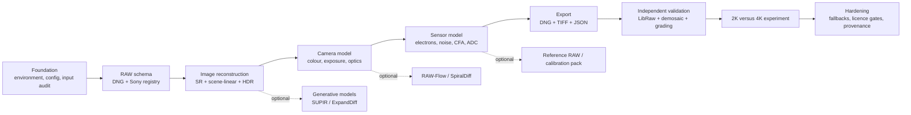

# Final PRD: Synthetic Sony-like 50 MP RAW Reconstruction Colab

## Executive summary

This PRD defines the **final production target for Claude Code**: one self-contained Google Colab notebook named `synthetic_camera_raw_50mp_colab.ipynb` that accepts a user-supplied 2K or 4K RGB JPEG/PNG and constructs a **coherent hypothetical physical-camera capture** at approximately 50 MP.

The notebook is **not an upscaler that merely writes larger integers**. Its job is to build an explicit, inspectable chain:

**rendered RGB → high-resolution structure → inferred scene-linear/HDR radiance → target-camera colour space → exposure → optical model → Bayer sampling → photoelectrons → shot/read/fixed-pattern noise → ADC codes → synthetic RAW container → conventional RAW development → 50 MP 16-bit TIFF.**

The supplied reference image is 2048 × 868 RGB with an embedded ICC profile and no EXIF capture metadata. At its native ~2.359:1 aspect ratio, a composition-preserving 50.1 MP target is approximately **10,872 × 4,608 = 50,098,176 pixels**. The notebook must also support a genuine Sony-like native sensor geometry rather than pretending that this wide aspect ratio corresponds to a real Sony sensor.

The default camera profile should therefore change to **Sony α1 II-like**. Sony specifies the α1 II at approximately 50.1 MP effective resolution, a full-frame 35.9 × 24.0 mm sensor, 8640 × 5760 pixels for its 3:2 50 MP still image, and Sony ARW 5.0 recording. citeturn13search0turn13search2 Sony states that its RAW recording is **14 bits per pixel** and supports uncompressed, losslessly compressed and compressed RAW modes. citeturn2search0turn1search11

Accordingly, the notebook needs two geometry modes:

| Mode | Sensor/output geometry | Meaning |
|---|---:|---|
| `SONY_A1II_NATIVE` | **8640 × 5760 = 49.77 MP** | Most physically credible Sony-like simulation |
| `CINEMA_50MP_VIRTUAL` | **10,872 × 4,608 ≈ 50.10 MP** | Preserves the supplied ~2.36:1 composition; explicitly a virtual Sony-like sensor |

The native Sony mode must use crop, sensor margins or vertical outpainting; **it must never stretch the source to 3:2**.

The primary RAW deliverable should remain **DNG, not a fabricated proprietary `.ARW`**. Sony's current ARW internals and MakerNotes are partly proprietary and model-dependent; ExifTool documents thousands of Sony structures through reverse engineering, including ARW version, RAW type, ISO/exposure fields, lens corrections and other MakerNote families, but that does not make Sony's complete proprietary writer format public. citeturn22search0turn22search1 Adobe DNG, by contrast, has a public specification and SDK; Adobe's current resources expose DNG Specification 1.7.1.0 and an SDK capable of DNG read/write. citeturn9view0turn10view0

The final output bundle should therefore be:

```text
synthetic_50mp.dng
developed_50mp_16bit.tif
scene_linear_50mp.exr                 # strongly recommended auxiliary
preview_8bit.png

sensor_mosaic_uint16.npy
sensor_expected_electrons.npy
sensor_noisy_electrons.npy

metadata.json
sony_arw_emulation.json
sensor_profile.json
provenance.json
config.json

validation_report.html
```

`sony_arw_emulation.json` is important. It allows the experiment to populate **every known/relevant Sony ARW field that can reasonably be modelled**, without inserting fraudulent Sony MakerNote blocks into the DNG. Every known Sony tag discovered at runtime should receive either a value or an explicit `UNSUPPORTED`/`UNKNOWN` reason.

The notebook must preserve four provenance classes:

| Code | Meaning |
|---|---|
| `D` — Deterministic | Fixed by input, selected geometry, selected format or mathematically derived from another field |
| `I` — Inferred | Estimated from the rendered RGB image |
| `F` — Fabricated | Information did not exist and is intentionally synthesised |
| `M` — Measured | Obtained from optional genuine target-camera RAW/calibration data |

For example, `ImageWidth` can be deterministic; white balance can be inferred; shot-noise realisation is fabricated; and black level can become measured when genuine reference RAWs are supplied.

The scientific boundary is non-negotiable:

> **The system generates a plausible physical explanation of the rendered image. It does not recover the physical exposure that actually happened.**

RGB-to-RAW is intrinsically underdetermined because rendering, tone mapping, white balance, colour correction, clipping and quantisation discard information. Brooks et al. explicitly constructed an “unprocessing” pipeline for synthesising plausible RAW measurements from finished images; recent RAW reconstruction work such as RAW-Flow continues to treat RGB→RAW as an ill-posed inverse problem rather than literal recovery. citeturn18search3turn17view3

This PRD supersedes the two preceding drafts. fileciteturn0file0 fileciteturn0file1 The main changes are a native 50 MP Sony target, a stricter ARW-versus-DNG boundary, an exhaustive field/provenance contract, a more conservative production model stack, storage-bit versus ADC-bit separation, dynamic Sony MakerNote enumeration, explicit runtime budgets and substantially stronger validation.

## Product scope and scientific architecture

The notebook must implement a **hybrid learned + physical simulator**, not a monolithic generative model.



The key architectural separation is:

**Spatial reconstruction asks:** *what fine structure could plausibly exist?*

**Radiance reconstruction asks:** *what continuous light intensities could plausibly have produced the visible RGB?*

**Sensor simulation asks:** *how would a selected hypothetical camera have measured that radiance?*

This prevents the notebook from confusing generated pores, fabric fibres or hair with sensor noise, or treating a Bayer pattern as a visual filter.

Brooks et al.'s unprocessing method provides a strong baseline for the inverse-ISP branch because it explicitly reverses gain, white balance, colour correction, gamma and tone mapping to generate RAW-like measurements from rendered images. citeturn18search3turn18search7 The default implementation should reproduce those principles in modern PyTorch/NumPy rather than depend on the historical TensorFlow code.

The notebook should implement three profile quality tiers:

| Profile source | Inputs | Scientific status |
|---|---|---|
| `IMAGE_ONLY` | JPEG/PNG | Camera parameters are inferred or synthetic |
| `REFERENCE_RAW` | JPEG/PNG + genuine Sony α1 II ARWs | Extract real CFA/levels/colour/WB/native geometry where exposed by decoder |
| `FULL_CALIBRATION` | Reference RAWs + dark frames + flat fields + colour/spectral calibration captures | Replace progressively more synthetic sensor statistics with measured parameters |

LibRaw is appropriate for the second and third modes because its stated purpose is to expose RAW pixel values plus the geometry, CFA/Bayer pattern, black level, white balance and related processing metadata required for RAW development. citeturn19search1turn19search11 rawpy provides Python access to black level per channel, camera white level, white balance, colour matrices and multiple demosaic options through LibRaw. citeturn19search2turn19search6

The notebook should **not infer a real sensor's wavelength-by-wavelength spectral response from this arbitrary AI image and call it Sony calibration**. Accurate camera spectral-sensitivity estimation normally requires calibration observations. For example, Makabe et al.'s ICCV 2025 method recovers camera spectral sensitivity by photographing direct illumination and its diffraction pattern through a grating. citeturn20search0turn20search2 Therefore image-only mode should use a camera-colour matrix approximation, while true spectral-response curves belong to `FULL_CALIBRATION`.

The α1 II profile should use Sony's documented operating envelope where appropriate: approximately 50.1 MP effective resolution, ISO 100–32000 standard with expanded still-image values reaching ISO 50–102400, and a 2500–9900 K colour-temperature range. citeturn13search2 Its shutter system includes mechanical and electronic modes; Sony publishes limits reaching 1/8000 s mechanically and 1/32000 s electronically. citeturn1search4 These ranges should constrain *candidate fabricated/inferred metadata*, not be presented as recovered settings.

The supplied 2048 × 868 image needs ~5.31× linear enlargement to reach the cinema 50.1 MP target. A 4096 × 1736 copy of the same composition needs only ~2.65×. That gives the planned 2K/4K experiment a precise purpose: measure how much less spatial information needs to be invented when more source pixels are provided.

## RAW, sensor and metadata synthesis specification

Adobe's DNG 1.7.1 specification should be the normative source for the synthetic RAW container. It defines CFA RAW interpretation, CFA pattern tags, linearisation, black level, white level, crop geometry, colour matrices, white balance, baseline exposure and noise-profile semantics. citeturn14view0turn14view1turn14view2turn14view4turn14view6 Sony-specific ARW/MakerNote names and encoded data types should be obtained from ExifTool's reverse-engineered Sony tag database. citeturn22search0turn22search1turn22search2

**Important implementation improvement:** distinguish **sensor ADC precision** from **DNG storage precision**.

For maximum decoder compatibility, the default should be:

```text
ADC_BITS              = 14
DNG_STORAGE_BITS      = 16
SENSOR_VALID_RANGE    = black_level ... <= 16383
TIFF/DNG ARRAY DTYPE  = uint16
```

A 16-bit storage word does not claim a 16-bit sensor. Sony documents 14-bit RAW for the α1 II. citeturn2search0 The separate experimental mode may set `ADC_BITS=16` and `WhiteLevel<=65535`, but its profile must be renamed `VIRTUAL_16BIT_SENSOR`; it can no longer be described as an α1 II ADC simulation.

The physical/sensor fields are:

| Field | Data type / representation | Allowed or design range | Dependency | Generation rule | Class |
|---|---|---|---|---|---|
| `sensor_width`, `sensor_height` | `uint32` | 8640×5760 native; 10872×4608 cinema virtual | Geometry mode | Fixed by profile | D |
| `active_area` | `uint32[4]` | Inside sensor bounds | Geometry | Whole sensor or calibrated optical-black margins | D/M |
| `default_crop_origin` | `uint32/rational[2]` | Inside active area | Source aspect | Native crop corresponding to composition | D |
| `default_crop_size` | `uint32/rational[2]` | ≤ active area | Crop mode | Preserve source composition | D |
| CFA phase | enum | `RGGB/BGGR/GRBG/GBRG` | Camera profile | Read from reference RAW; otherwise selectable | M/F |
| Per-photosite clean signal | `float32 H×W` | ≥0 | Camera RGB + CFA | Select one channel per photosite | D after upstream reconstruction |
| Per-photosite electrons | `float32 H×W` | 0…full well | Exposure/sensor profile | Radiance × exposure × sensor gain | F/M |
| ADC codes | `uint16 H×W` | black…white | Noise/electronics | Quantise simulated analogue signal | D/F |
| ADC precision | `uint8` | 14 default; 16 experimental | Profile | α1 II-like=14 | D |
| `BlackLevel` | rational/integer | `0 ≤ black < white` | Sensor profile | Reference extraction or synthetic pedestal | M/F |
| `BlackLevelDeltaH/V` | `SRATIONAL[]` | Small signed offsets | FPN model | Row/column black-level structure | F/M |
| `WhiteLevel` | `uint16/uint32` | ≤16383 for 14-bit ADC | ADC/saturation | Saturation code | D/M |
| `LinearizationTable` | `uint16[]` | monotonic | Sensor non-linearity toggle | Identity by default | D/F |
| Full-well capacity | `float32`, electrons | **20k–100k e⁻ engineering prior** | Sensor profile | User/calibration prior | F/M |
| Conversion gain | `float32 e⁻/DN` | **0.1–4 e⁻/DN engineering prior** | Full well + ADC | Derived/calibrated | F/M |
| Read noise | `float32 e⁻ RMS` | **0.3–10 e⁻ engineering prior** | ISO/gain | Calibration or synthetic ISO curve | F/M |
| Shot noise | Poisson random variable | Signal dependent | Electron expectation | `Poisson(expected_e)` | F |
| Dark current | `float32 e⁻/px/s` | 0–10 design prior | Exposure/temp | Optional | F/M |
| PRNU | multiplicative map | 0–3% σ design prior | Sensor body ID | Fixed map per virtual body | F/M |
| DSNU | additive map | 0–64 DN σ design prior | Sensor body/temp | Fixed map per virtual body | F/M |
| Row/column FPN | additive vectors | configurable | Readout model | Fixed per virtual body | F/M |
| Hot/dead pixels | coordinate set | 0–1000 ppm design prior | Body ID | Fixed per body or reference-derived | F/M |
| Spectral sensitivities | `float32[3,Nλ]` | 0–1 normalised | Physical calibration | Calibration captures only; otherwise omitted | M/F-exp |
| Camera colour transform | 3×3 rational matrix | finite, invertible | profile/illuminant | Reference DNG matrix or fitted approximation | M/F |
| `AnalogBalance` | rational vector | >0 | camera profile | reference or identity/synthetic | M/F |
| Scene radiance | `float32 RGB` | ≥0 | inverse ISP/HDR | inferred continuous representation | I/F |
| HDR confidence | `float16/32 H×W` | 0–1 | HDR model | model/heuristic confidence | I |
| Highlight synthesis mask | boolean | 0/1 | source clipping | regions requiring invented radiance | D/I |
| Shadow synthesis mask | boolean | 0/1 | source clipping | regions requiring invented radiance | D/I |

The full-well/read-noise/PRNU/DSNU numeric intervals above are **deliberately broad simulation priors, not claimed Sony α1 II specifications**. Full calibration mode should supersede them with measured results. EMVA 1288 is the appropriate conceptual framework for measuring camera noise and sensor non-uniformity rather than choosing these quantities aesthetically; EMVA continues to maintain the standard and has moved it towards ISO standardisation. citeturn23search6turn23search8

DNG's own `NoiseProfile` should be generated from the **same noise parameters actually applied to the pixels**. DNG 1.7.1 defines its per-plane model as a signal-dependent term plus signal-independent read-noise term, with `S > 0` and `O ≥ 0`; the specification explicitly notes that fixed-pattern and pixel-response non-uniformity are outside that simple profile. citeturn11view1 This is why PRNU, DSNU and FPN remain separate sidecar/simulation parameters.

The DNG/EXIF field contract is:

| Field/tag | DNG/EXIF type | Valid design range | How populated | Class |
|---|---|---|---|---|
| `DNGVersion` | `BYTE[4]` | writer-supported version | Fixed to supported DNG version | D |
| `DNGBackwardVersion` | `BYTE[4]` | lowest version compatible with emitted tags | Writer computes | D |
| `ImageWidth/Length` | TIFF integer | selected geometry | Geometry planner | D |
| `BitsPerSample` | TIFF SHORT | 16 default storage; validated packed-14 optional | Writer | D |
| `SamplesPerPixel` | SHORT | `1` | CFA RAW | D |
| `PhotometricInterpretation` | SHORT | CFA | CFA RAW | D |
| `Compression` | SHORT | uncompressed default; optional validated lossless mode | Writer toggle | D |
| `CFARepeatPatternDim` | SHORT[2] | `[2,2]` for Bayer | Profile | D |
| `CFAPattern` | BYTE[4] | chosen 2×2 CFA phase | Profile | M/F |
| `CFAPlaneColor` | BYTE[3] | R,G,B mapping | CFA specification | D |
| `CFALayout` | SHORT | rectangular default | CFA layout | D |
| `BlackLevelRepeatDim` | SHORT[2] | usually 1×1 or 2×2 | Sensor profile | D/M |
| `BlackLevel` | SHORT/LONG/RATIONAL | < WhiteLevel | Sensor simulator | M/F |
| `WhiteLevel` | SHORT/LONG | ≤ ADC maximum | Sensor simulator | D/M |
| `ColorMatrix1/2` | `SRATIONAL[9]` | finite/invertible | calibration/reference/profile | M/F |
| `CalibrationIlluminant1/2` | SHORT | legal EXIF illuminant IDs | matrices/profile | D/M/F |
| `CameraCalibration1/2` | `SRATIONAL[9]` | identity or calibrated | calibration mode | M/F |
| `ForwardMatrix1/2` | rational matrix | optional | calibrated profile only | M/F |
| `AnalogBalance` | rational[3] | positive | camera profile | M/F |
| `AsShotNeutral` | rational[3] | positive | WB estimator/manual | I |
| `AsShotWhiteXY` | rational[2] | alternate to AsShotNeutral | normally omit if AsShotNeutral used | I |
| `BaselineExposure` | SRATIONAL | design −5…+5 EV | reconstructed headroom | I/F |
| `BaselineNoise` | RATIONAL | >0 | camera profile | M/F |
| `BaselineSharpness` | RATIONAL | >0 | rendering profile | F |
| `LinearResponseLimit` | RATIONAL | 0…1 | profile | M/F |
| `AntiAliasStrength` | RATIONAL | 0…1 | selected virtual optical profile | F/M |
| `BayerGreenSplit` | LONG | ≥0 | reference only unless modelled | M/F-exp |
| `NoiseProfile` | DOUBLE[2] or per-plane pairs | `S>0`, `O≥0` | same sensor-noise model | D |
| `NoiseReductionApplied` | RATIONAL | pipeline state | `0` for un-denoised synthetic RAW | D |
| `LensInfo` | RATIONAL[4] | lens-dependent | selected/inferred profile | I/F/M |
| `Orientation` | SHORT | EXIF orientation enum | source orientation | D |
| `ExposureTime` | RATIONAL | Sony-profile-constrained candidates | joint exposure inference/manual | I/F |
| `ShutterSpeedValue` | SRATIONAL | derived | ExposureTime | D |
| `FNumber` | RATIONAL | selected lens range | blur/exposure inference/manual | I/F |
| `ApertureValue` | RATIONAL | derived | FNumber | D |
| `PhotographicSensitivity` | SHORT/LONG | target profile range | exposure posterior/manual | I/F |
| `ExposureBiasValue` | SRATIONAL | e.g. −5…+5 EV design range | exposure state | I/F |
| `MeteringMode` | SHORT enum | EXIF enum | no reliable recovery | F |
| `ExposureProgram` | SHORT enum | EXIF enum | user/profile choice | F |
| `FocalLength` | RATIONAL | selected lens range | GeoCalib/FOV/lens hypothesis | I |
| `FocalLengthIn35mmFormat` | SHORT | derived | sensor size + FOV | D/I |
| `LightSource` | SHORT enum | EXIF enum | illuminant estimate | I |
| `Flash` | SHORT bitfield | EXIF semantics | scene/manual hypothesis | I/F |
| `LensMake/Model` | ASCII | selected profile | user/inference | I/F |
| `DateTimeOriginal` | ASCII | valid date-time | **never infer actual date** | F/User |
| `GPS*` | EXIF GPS types | valid coordinates | **user only by default** | F/User |
| Camera serial | ASCII | synthetic token only | never imitate a real Sony serial | F/User |
| `Software` | ASCII | notebook version/git hash | fixed | D |
| `ImageDescription` | ASCII | synthetic disclosure | fixed | D |
| `UniqueCameraModel` | ASCII | unique synthetic profile | fixed | D |

DNG explicitly defines `BlackLevel` as the zero-light encoding level and `WhiteLevel` as the saturated RAW encoding value. citeturn14view1turn14view2 It also requires `ColorMatrix1` for non-monochrome DNGs and defines `AsShotNeutral` as capture white-balance coordinates; `BaselineExposure` expresses the model-specific exposure-zero-point/headroom relationship. citeturn14view4turn14view6 `LensInfo` stores minimum/maximum focal length and maximum-aperture information. citeturn14view7

For α1 II-like exposure metadata, constrain candidates to Sony's supported ranges rather than arbitrary values. The camera's standard still-image ISO range is 100–32000, with expansion to 50–102400, and its colour-temperature setting spans 2500–9900 K. citeturn13search2 Exposure time, aperture and ISO nevertheless remain **non-identifiable from final rendered RGB**; the notebook should output a posterior/candidate set, not pretend to recover a unique triple.

The Sony ARW-emulation registry must cover at least these families:

| Sony ARW / MakerNote family | Representative fields | Notebook policy |
|---|---|---|
| File identity | `FileFormat`, `SonyRawFileType`, `SonyRawImageSize`, `Quality`, `Quality2`, `SonyModelID` | Populate profile-consistent value where known; keep unknown numeric Sony model IDs null |
| Exposure | `SonyISO`, `BaseISO`, `StopsAboveBaseISO`, `SonyExposureTime2`, `ExposureTime`, `SonyFNumber`, max aperture | Infer/derive |
| Shutter | `ShutterType` | Selected electronic/mechanical profile |
| Image geometry | `SonyImageWidthMax`, `SonyImageHeightMax`, aspect | Derive |
| WB/colour | Sony WB preset/temperature/shift fields where present | Infer or fabricate |
| Rendering | `CreativeStyle`, `PictureEffect`, sharpness, DRO/HDR state | Fabricated/user-set |
| Noise processing | High-ISO NR, long-exposure NR | Default off in clean RAW simulation |
| Lens identity | `LensFormat`, `LensMount`, `LensType`, `LensType2/3`, E-mount versions | Reference/user/inference |
| Lens corrections | distortion, vignetting, CA flags and parameter arrays | Exactly reflect enabled optical simulator |
| AF/focus | FocusMode, AF area/point/status, focus distance fields | Low-confidence or fabricated |
| Drive/release | release mode, sequence number, self timer | Fabricated |
| Temperature | camera/sensor/board temperature | user/fabricated, never inferred confidently |
| Battery | battery level | fabricated only |
| Body identity | internal serial, serial number, shutter count | **null by default; never realistic fake identity** |
| Firmware | firmware version | profile/user; otherwise unknown |
| Date/time/GPS | Sony date/time and location | user only by default |

ExifTool identifies Sony `FileFormat` as an `int8u[4]` field and maps `'5 0 0 0'` to ARW 5.0; it also documents fields including `SonyISO`, `BaseISO`, exposure time, f-number, lens mount/type, shutter type, noise-reduction settings and signed arrays for distortion, vignetting and chromatic-aberration correction. citeturn22search1 Its EXIF documentation also exposes Sony ARW-specific `SonyRawFileType`, `SonyRawImageSize` and correction blocks. citeturn22search2 Sony independently identifies the α1 II recording format as ARW 5.0. citeturn13search2

To fulfil the requirement to cover **every currently known Sony field**, Claude Code must not hard-code this table as the final universe. At notebook setup it should:

```text
Install ExifTool
        ↓
Export ExifTool's current tag catalogue
        ↓
Filter Sony / SonyIDC / Sony-related ARW tag tables
        ↓
Build sony_tag_registry.json
        ↓
For every discovered field:
    field_name
    ExifTool data type
    writable/read-only state
    recognised enum values where available
    notebook implementation state
    generated value
    provenance
    confidence
    unsupported_reason
```

ExifTool's tag catalogue states that its documentation is built from decades of research, testing and reverse engineering and is updated as new tags become understood. citeturn22search0 This dynamic registry is much stronger than freezing a 2026 PRD to a fixed list.

The DNG itself should **not contain a synthetic Sony MakerNote binary block by default**. Standard DNG/EXIF fields go into the DNG; full Sony-like fields go into `sony_arw_emulation.json`. A future experimental MakerNote writer may be enabled only after binary compatibility is verified against a real α1 II file structure.

## Model and method selection

The production notebook should **always have a non-generative physical path that works**. Heavy learned models are optional improvements, not hard dependencies.

| Stage | Candidate | Licence / availability | Colab suitability | Final recommendation |
|---|---|---|---|---|
| Fidelity SR | **SwinIR** | Apache-2.0; official pretrained SR/restoration models and Colab example | Good with tiling | **Default fidelity baseline** |
| Higher-end fidelity SR | **HAT / Real-HAT** | Apache-2.0; official tile support | Good, somewhat heavier | Preferred optional quality mode |
| Practical restoration SR | **Real-ESRGAN** | BSD-3-Clause; official x2/x4 restoration models | Excellent | **Primary fallback / artifact-heavy input** |
| Generative restoration | **SUPIR** | Restrictive/non-commercial terms | Heavy | Experimental only |
| HDR reconstruction | **ExpandDiff** | Very recent 2026 research/code | Experimental | Optional generative HDR |
| HDR alternative | **Vid2HDRImg** | MIT code; depends on Stable Video Diffusion licence | Very heavy | Off by default |
| RGB→scene-linear | Brooks-style unprocessing | Algorithm/paper/reference code | Very light | **Mandatory baseline** |
| RGB→RAW | **RAW-Flow** | MIT; official checkpoints | Moderate | Optional learned prior |
| Camera-conditioned RGB→RAW | **SpiralDiff** | MIT repository | Experimental | Optional research backend |
| Camera geometry | **GeoCalib** | Apache-2.0 code; CC BY 4.0 weights | Light/moderate | **Preferred** |
| Sensor noise | Physical Poisson + electronic model | No checkpoint | Very light | **Mandatory default** |
| Spectral response | Grating calibration method | Research code/data available | Calibration workflow | Full-calibration only |
| Bayer generation | Analytic CFA sampler | No model | Negligible | **Mandatory** |
| Demosaicing/validation | LibRaw/rawpy | LibRaw LGPL/CDDL; rawpy interface | Light | **Mandatory validator** |
| DNG writing | PiDNG or internal DNG writer | PiDNG MIT | Light | Preferred prototype backend |
| DNG conformance | Adobe DNG SDK / independent decoder | Adobe reference SDK | Build step | Validation tier |

SwinIR's official repository covers classical and real-world super-resolution, denoising and JPEG artifact removal, provides x2/x3/x4/x8 classical SR checkpoints and an official Colab workflow, and is Apache-2.0 licensed. citeturn16search0 HAT is also Apache-2.0 and its official project explicitly supports tiled inference for restricted memory. citeturn17view0 Real-ESRGAN's official repository is BSD-3-Clause and is designed for practical general-image restoration, making it a useful robust fallback. citeturn17view1

SUPIR should never be silently downloaded by the default notebook. Its own licence contains use restrictions, so `ENABLE_SUPIR=True` must display a licence warning before checkpoint installation. citeturn17view2

For the supplied clean AI render, the default should be:

```text
SR_MODE = FIDELITY

2K source:
    x4 fidelity SR
    → ~8192 × 3472
    → edge-preserving exact resize to target 10872 × 4608

4K source:
    choose nearest suitable x2/x4 backend
    → reconstruct past or close to target
    → exact resize to target

GENERATIVE_MICROTEXTURE = OFF
```

This avoids two serial generative enlargements unless the user explicitly enables them.

For HDR/bit-depth expansion, the notebook should **not contain a standalone “8-bit-to-16-bit network”**. The scientifically meaningful path is:

```text
8-bit encoded RGB
→ inverse transfer function
→ inverse tone rendering
→ continuous float radiance
→ reconstruct clipped radiance
→ camera/sensor simulation
→ high-precision sensor codes
```

ExpandDiff, published in September 2026, directly tackles single-image HDR reconstruction by jointly synthesising clipped shadows and highlights with conditional diffusion. citeturn23academia48 It is conceptually well matched to this project, but because it is extremely recent, the production notebook must treat it as **experimental** and preserve a deterministic fallback.

That fallback should implement mask-constrained inverse tone mapping:

```text
non-clipped source:
    preserve source-derived radiance as strongly as possible

near-white clipped regions:
    extrapolate shoulder smoothly up to configured EV headroom

near-black clipped regions:
    extrapolate toe smoothly down to configured shadow latitude

fully destroyed regions:
    explicitly mark as GENERATED
```

`Vid2HDRImg` is another 2026 option: its official implementation generates an exposure bracket using a video-diffusion prior and then fuses that stack into HDR, but its underlying Stable Video Diffusion dependency makes it substantially heavier and subject to additional model licensing. citeturn23search2 It belongs behind an expert toggle, not in the default path.

For RGB→RAW, use two layers:

```text
PHYSICS_BASELINE = ALWAYS ON
LEARNED_INVERSE_ISP = optional
```

RAW-Flow is relevant because its official AAAI 2026 implementation explicitly targets RGB-to-RAW reconstruction, but the released pretrained camera checkpoints are not a Sony α1 II model. citeturn17view3 Therefore it can provide a learned prior, not unquestioned Sony ground truth.

SpiralDiff can be exposed as another experimental camera-conditioned inverse-ISP backend. Its official repository is MIT-licensed. citeturn17view4 Claude Code must inspect the installed checkpoint's supported camera domain at runtime and never label an unsupported checkpoint “Sony α1 II”.

For geometric camera cues, GeoCalib should be the default optional model. Its official implementation estimates single-image camera calibration and is Apache-2.0, while the distributed learned weights are CC BY 4.0. citeturn16search1 Its focal/FOV estimates can constrain a plausible lens hypothesis, but they do **not** identify a particular Sony lens with certainty.

Sensor noise should remain physical by default. DNG itself supplies the right validation model for signal-dependent shot noise and signal-independent read noise. citeturn11view1 A learned “grain generator” is less useful for this experiment than explicitly preserving expected electrons, noisy electrons, fixed pattern and ADC states as separate arrays.

Spectral response has three modes:

```text
SPECTRAL_MODE = "MATRIX_ONLY"        # default
SPECTRAL_MODE = "REFERENCE_PROFILE"  # genuine reference RAW
SPECTRAL_MODE = "CALIBRATED_CURVES"  # actual calibration capture
```

The third mode may integrate the ICCV 2025 grating calibration pipeline because its purpose is specifically to estimate camera spectral sensitivity from calibration photographs. citeturn20search0turn20search1 An `INFER_SPECTRAL_RESPONSE_FROM_AI_IMAGE` option may exist only under an **EXPERIMENTAL / LOW CONFIDENCE** section and must never replace calibrated values.

For DNG writing, PiDNG is a reasonable Python-native starting point because its repository supports Bayer RAW, DNG tags and 8/10/12/14/16-bit precision under an MIT licence. citeturn23search9 The final notebook must nonetheless independently reopen its output through LibRaw/rawpy; a DNG that only the notebook's own writer/reader understands is a failure.

## Notebook architecture, controls and compute budget

The notebook must be a **single file**:

```text
synthetic_camera_raw_50mp_colab.ipynb
```

No user should need to edit Python source to perform the core experiment. Configuration must be through one strongly typed configuration object plus an `ipywidgets` control panel.

The notebook sections, in execution order, must be:

```text
Environment + reproducibility
Input audit
Profile selection
Target geometry
Source diagnostics
SR reconstruction
HDR / scene-linear reconstruction
Camera geometry + exposure inference
Inverse ISP / camera colour
Optical forward model
Sensor/electron simulation
CFA construction
ADC quantisation
Metadata construction
DNG export
RAW round-trip development
16-bit TIFF export
Validation suite
2K/4K comparison
Provenance + report packaging
```

Google explicitly notes that Colab resources are not guaranteed or unlimited and that available accelerator types and usage limits can vary. citeturn18search10turn18search14 Therefore Claude Code must detect the actual runtime rather than assume an A100.

At startup print:

```text
GPU model
GPU VRAM
CUDA version
PyTorch version
system RAM
free disk
CPU core count
```

The notebook should then derive tile parameters.

A 50.098 MP array has significant memory cost even before neural-network activations:

| Representation | Approx. memory |
|---|---:|
| One 50.1 MP RGB `float32` image | **0.56 GiB** |
| One 50.1 MP RGB `float16` image | **0.28 GiB** |
| One 50.1 MP RGB `uint16` image | **0.28 GiB** |
| One 50.1 MP CFA `uint16` mosaic | **0.093 GiB** |
| One scalar 50.1 MP `float32` map | **0.187 GiB** |

Consequently, keeping ten full-resolution float intermediates resident can consume several gigabytes even before model activations. The notebook must checkpoint completed stages to host RAM/disk, delete GPU tensors between stages and reload only the arrays required for the next operation.

Recommended runtime tiers are **engineering budgets**, not guaranteed benchmarks because Colab hardware varies:

| Runtime class | VRAM | Core pipeline target | Heavy generative mode |
|---|---:|---:|---:|
| T4-class | ~16 GB | ~20–60 min | ~45–120+ min |
| L4-class | ~24 GB | ~10–35 min | ~30–75 min |
| A100-class | 40 GB+ | ~6–20 min | ~15–45 min |
| CPU-only | — | Sensor/metadata stages only practical | Do not attempt heavy SR/diffusion |

Claude Code should **benchmark the first few tiles** and display an extrapolated ETA rather than relying on hard-coded estimates.

Recommended tile defaults:

```text
>= 40 GB VRAM:
    768 px tiles where backend allows

20–39 GB:
    512 px

12–19 GB:
    256–384 px

<12 GB:
    192–256 px + aggressive offload
```

Use overlap of approximately 32–96 pixels depending on model receptive field, reflection padding and weighted blending. A seam diagnostic must compare boundary residuals to ordinary interior residuals.

The required configuration surface is:

```python
TARGET_PROFILE = "SONY_A1II_LIKE"

OUTPUT_GEOMETRY = "SONY_A1II_NATIVE"
# or CINEMA_50MP_VIRTUAL

SENSOR_FIT_MODE = "OUTPAINT_VERTICAL"
# CROP_HORIZONTAL
# FIT_WITH_SENSOR_MARGINS

SR_BACKEND = "SWINIR"
# HAT
# REAL_ESRGAN
# SUPIR
# LANCZOS

SR_MODE = "FIDELITY"
GENERATIVE_DETAIL_STRENGTH = 0.0

HDR_ENABLED = True
HDR_BACKEND = "DETERMINISTIC"
# EXPANDDIFF
# VID2HDR
HDR_HIGHLIGHT_EV = 3.0
HDR_SHADOW_EV = 3.0

INVERSE_ISP = "PHYSICS"
USE_RAW_FLOW = False
USE_SPIRALDIFF = False

CAMERA_PROFILE_SOURCE = "IMAGE_ONLY"
# REFERENCE_RAW
# FULL_CALIBRATION

SPECTRAL_MODE = "MATRIX_ONLY"

EXPOSURE_MODE = "POSTERIOR"
# MANUAL
# PROFILE_DEFAULT

ADC_BITS = 14
EXPERIMENTAL_16BIT_SENSOR = False

SHOT_NOISE = True
READ_NOISE = True
PRNU = False
DSNU = False
ROW_FPN = False
COLUMN_FPN = False
DARK_CURRENT = False
HOT_PIXELS = False
DEAD_PIXELS = False

OPTICAL_SIMULATION = False
DISTORTION = False
VIGNETTING = False
CHROMATIC_ABERRATION = False
DIFFRACTION = False
DEFOCUS = False

DNG_STORAGE_BITS = 16
DNG_COMPRESSION = "UNCOMPRESSED"

GENERATE_SYNTHETIC_EXIF = True
FABRICATE_UNOBSERVABLE_EXIF = False

WRITE_DNG = True
WRITE_TIFF16 = True
WRITE_EXR = True
WRITE_METADATA_JSON = True
WRITE_SONY_ARW_EMULATION_JSON = True
WRITE_VALIDATION_REPORT = True
WRITE_C2PA = True

SCENE_SEED = 42
SENSOR_NOISE_SEED = 42001
SENSOR_BODY_SEED = 42002
N_SENSOR_REALISATIONS = 1
```

The acceptance contract for key toggles is:

| Toggle | Expected effect | Acceptance criterion |
|---|---|---|
| `SONY_A1II_NATIVE` | 8640×5760 Bayer sensor | No aspect stretching; crop/outpaint policy recorded |
| `CINEMA_50MP_VIRTUAL` | 10872×4608 virtual sensor | Profile name says virtual, never native Sony |
| `SR_BACKEND` | Changes reconstructed detail | Source-scale downsample stays structurally faithful |
| `GENERATIVE_DETAIL_STRENGTH` | Adds plausible unseen texture | `generated_detail_mask/confidence` written |
| `HDR_ENABLED` | Adds continuous radiance/headroom | All created radiance tracked by masks |
| `HDR_*_EV` | Controls fabricated tonal latitude | No negative/NaN radiance; exposure tests remain stable |
| `USE_RAW_FLOW` | Learned inverse-ISP prior | Output labelled cross-camera unless Sony-trained |
| `SPECTRAL_MODE` | Controls physical colour model | `CALIBRATED_CURVES` forbidden without calibration assets |
| `ADC_BITS=14` | Sony-like quantisation | Valid signal never exceeds 16383 before storage packing |
| `EXPERIMENTAL_16BIT_SENSOR` | Fabricates full 16-bit ADC | Camera profile automatically renamed virtual |
| `SHOT_NOISE` | Signal-dependent variation | Mean/variance slope appears in validation |
| `READ_NOISE` | Signal-independent noise floor | Dark-region variance changes |
| `PRNU/DSNU/FPN` | Fixed body signature | Same body seed preserves pattern across exposures |
| `OPTICAL_SIMULATION` | Adds target-lens effects | Applied before CFA, never after demosaic |
| `FABRICATE_UNOBSERVABLE_EXIF` | Creates temp/battery/time/etc. | Every value marked `F`; serial uses synthetic namespace |
| `WRITE_DNG` | Standard RAW container | Must reopen with independent LibRaw decoder |
| `WRITE_C2PA` | Machine-readable provenance | AI/synthetic action visible if signer/tooling available |

The optical order must remain physically sensible:

```text
scene radiance
→ lens blur / diffraction / defocus
→ geometric distortion
→ vignetting
→ chromatic effects
→ sensor sampling
→ sensor noise/electronics
```

Do not add lens aberrations after Bayer sampling merely because they are easy to implement there.

The sensor-noise core should operate in electrons:

```text
expected_e = max(scene_signal, 0) * full_well

shot_e = Poisson(expected_e)

responsive_e = shot_e * PRNU_map

read_e = Normal(0, read_noise_sigma)

dark_e = dark_current * exposure_time + DSNU

sensor_e =
    responsive_e
    + read_e
    + dark_e
    + row_offset
    + column_offset

analogue_DN =
    sensor_e / conversion_gain

stored_DN =
    round(
        analogue_DN
        + black_level
    )

clip to WhiteLevel
```

The PRNU/DSNU/hot-pixel map must use `SENSOR_BODY_SEED`, so a hypothetical body retains the same defects from exposure to exposure. Shot/read noise must use `SENSOR_NOISE_SEED`, so repeated exposures change noise while keeping the sensor body's structure fixed.

Sony ARW compression and DNG compression must be treated as **different things**. Sony documents the camera's selectable uncompressed, lossless-compressed and compressed RAW modes. citeturn1search11turn2search0 The DNG should default to uncompressed for maximum inspectability. An `ARW_COMPRESSION_EMULATION` field can record the hypothetical Sony setting in the sidecar; the notebook should not attempt to recreate Sony's proprietary compression bitstream.

The developed TIFF requirement is:

```text
Filename:
developed_50mp_16bit.tif

Geometry:
selected final delivery geometry

Channels:
RGB

Precision:
16-bit unsigned integer/channel

Colour:
wide-gamut developed RGB with embedded ICC profile

Source:
developed from the synthetic DNG through the independent RAW path
```

Also export:

```text
scene_linear_50mp.exr
```

as a float scene-linear master. The EXR is not a replacement for the requested TIFF; it simply prevents the experiment from losing the unclamped float radiance representation after spending substantial effort reconstructing it.

## Validation, outputs and production acceptance

Validation must answer **four different questions**:

**Is the final image visually convincing?**

**Is the RAW internally physically/statistically coherent?**

**Does it survive ordinary RAW development?**

**How much information was actually supported by the input versus fabricated?**

A good-looking 50 MP TIFF is not enough.

The first hard gate is DNG conformance. Adobe defines CFA RAW using `PhotometricInterpretation=CFA`, `CFARepeatPatternDim` and `CFAPattern`; it also specifies that CFA plane mapping and black/white levels reside in the RAW IFD. citeturn14view0turn14view1turn14view2 The generated DNG must open in at least **LibRaw/rawpy independently of the writer**. rawpy exposes 16-bit output, camera/user white balance, exposure shift, highlight controls and multiple demosaic algorithms, making it appropriate for automated stress testing. citeturn19search2turn19search6

Required automated validation sequence:

```text
synthetic DNG
      ↓
LibRaw/rawpy reopen
      ↓
validate CFA / levels / metadata
      ↓
develop with default AHD
      ↓
develop with AMAZE where supported
      ↓
develop with at least one additional algorithm
      ↓
render 0 EV
      ↓
render -4 ... +4 EV
      ↓
render cool / neutral / warm WB
      ↓
compare 0 EV round trip with source-derived target
```

RawTherapee should be an optional second independent processor. If available in the Colab package environment, perform the same neutral render through its CLI and include the result. If package availability fails, **do not fail the experiment**; LibRaw compatibility remains the mandatory gate.

The numerical tests are:

| Domain | Metric/test | Production criterion |
|---|---|---|
| DNG structure | Independent reopen | **Hard pass** |
| CFA | one value/photosite; correct periodic phase | **Hard pass** |
| Numeric health | NaN/Inf/out-of-range | **zero failures** |
| ADC | values obey black/white/bit-depth contract | **Hard pass** |
| Round trip | source-supported-region SSIM | target **≥0.97** after alignment/tone normalisation |
| Round trip | whole-image SSIM | target **≥0.93** |
| Colour | median ΔE00 on source-supported pixels | target **≤2.5** after global colour alignment |
| SR seams | boundary residual vs interior residual | target **<1.25×** |
| HDR | negative radiance | **0 pixels** |
| HDR | generated HDR area | report percentage, no arbitrary pass |
| Noise | fitted `Var = S·mean + O` | coefficients agree with metadata within **5%** on synthetic flats |
| Noise | variance-fit R² on test flats | target **≥0.95** |
| WB | cool/warm changes | monotonic, no channel blow-up |
| Exposure | −4…+4 EV development | no unexpected discontinuities/NaNs |
| Determinism | clean scene, same seed/config | reproducible within backend tolerance |
| Sensor stochasticity | noise seed change | scene structure unchanged |
| Body signature | body seed unchanged | PRNU/DSNU/defect map unchanged |
| Metadata | dependency validator | **zero impossible combinations** |

The SSIM/ΔE thresholds are **project QA targets**, not claims about published model performance. If the first implementation consistently misses them, Claude Code should report the measured baseline and expose thresholds as configuration rather than quietly altering output.

The notebook must generate artificial flat-field patches at multiple signal levels specifically for sensor validation. This makes the noise model testable independently of the complex supplied photograph.

For each level:

```text
Generate clean uniform sensor signal
Generate N >= 32 noisy realisations
Measure mean
Measure variance
Fit variance = S*mean + O
Compare S/O with NoiseProfile
Plot residuals
```

This directly tests the DNG noise model described by Adobe. citeturn11view1

Colour-profile consistency must include:

```text
ColorMatrix determinant != 0
matrix condition number reported
white point maps to near-neutral
AsShotNeutral produces neutral response
ColorMatrix1/2 interpolation stays finite
no negative/NaN transformed channels before clipping
```

When a genuine reference camera profile is supplied, compare synthetic and real camera-space neutrals and colour patches.

HDR validation must distinguish values reconstructed from surviving pixels from values created in clipped regions. Export:

```text
source_supported_mask.npy
highlight_fabricated_mask.npy
shadow_fabricated_mask.npy
hdr_confidence.npy
```

Single-image HDR methods necessarily infer unavailable clipped information; ExpandDiff itself describes the task as reconstructing missing detail in clipped shadow/highlight areas. citeturn23academia48 The notebook should visualise these areas rather than conceal them.

For the 2K-versus-4K experiment, lock:

```text
camera profile
output geometry
SR backend
HDR backend
tone inversion
exposure hypothesis
white balance
lens profile
sensor parameters
camera colour matrices
scene seed
sensor-body seed
sensor-noise seed
development settings
```

Only source resolution may vary.

Produce:

```text
comparison_2k_vs_4k.html
```

containing:

| Test | Purpose |
|---|---|
| Final 50 MP difference map | See where source resolution matters |
| Edge agreement | Detect structure changes |
| Texture agreement | Detect hallucination instability |
| Face/skin crop | Identity/fidelity |
| Hair crop | Fine-frequency reconstruction |
| Saree/fabric crop | Repetitive texture reconstruction |
| Jewellery crop | hard high-frequency structure |
| Smoke crop | translucent gradient behaviour |
| Bokeh-light crop | HDR/blur behaviour |
| Exposure-posterior comparison | Test metadata stability |
| WB comparison | Test colour inference stability |
| HDR-mask comparison | Test radiance reconstruction stability |
| DNG stats | Compare synthetic sensor distribution |

A camera parameter such as hypothetical ISO or focal length should not wildly change simply because the exact same content was provided at twice the linear source resolution. If it does, flag `ESTIMATOR_UNSTABLE`.

A user study should be included as an optional report generator rather than run automatically. The suggested protocol is:

```text
10–20 observers minimum for an internal experiment

Randomised blinded pairs:
A = 2K-derived 50 MP
B = 4K-derived 50 MP

Also:
fidelity SR vs generative SR
noise off vs sensor noise on
normal upscale vs full sensor reconstruction

Display matched 100% crops

Ask separately:
1. Which looks more photographic?
2. Which better preserves the original subject?
3. Which looks less AI-generated?
4. Which has more believable fine detail?
5. Which tolerates the graded exposure/WB edit better?
```

Do not combine photographic realism and content fidelity into one rating: aggressive generative reconstruction may improve one while degrading the other.

The exact output tree is:

```text
run_YYYYMMDD_HHMMSS/
│
├── source/
│   ├── source_original.ext
│   └── source_sha256.txt
│
├── raw/
│   ├── synthetic_50mp.dng
│   └── sensor_mosaic_uint16.npy
│
├── masters/
│   ├── developed_50mp_16bit.tif
│   ├── scene_linear_50mp.exr
│   └── preview_8bit.png
│
├── metadata/
│   ├── metadata.json
│   ├── sony_arw_emulation.json
│   ├── sony_tag_registry.json
│   ├── sensor_profile.json
│   ├── camera_profile.json
│   ├── provenance.json
│   └── config.json
│
├── intermediates/
│   ├── 01_input_rgb.npy
│   ├── 02_sr_rgb.npy
│   ├── 03_scene_linear.npy
│   ├── 04_hdr_radiance.npy
│   ├── 05_camera_native_rgb.npy
│   ├── 06_optical_sensor_rgb.npy
│   ├── 07_expected_electrons.npy
│   ├── 08_noisy_electrons.npy
│   ├── 09_clean_cfa.npy
│   ├── 10_noisy_cfa.npy
│   └── 11_adc_codes.npy
│
├── confidence/
│   ├── generated_detail_mask.npy
│   ├── source_supported_mask.npy
│   ├── highlight_fabricated_mask.npy
│   ├── shadow_fabricated_mask.npy
│   └── hdr_confidence.npy
│
├── validation/
│   ├── input_histograms.png
│   ├── clipping_masks.png
│   ├── tile_seam_map.png
│   ├── roundtrip_difference.png
│   ├── cfa_planes.png
│   ├── mean_variance_curve.png
│   ├── noise_histograms.png
│   ├── noise_psd.png
│   ├── colour_validation.png
│   ├── wb_contact_sheet.png
│   ├── exposure_contact_sheet.png
│   ├── demosaic_comparison.png
│   └── validation_report.html
│
└── logs/
    ├── environment.json
    ├── model_manifest.json
    └── execution.log
```

Each major field in `metadata.json` must follow a schema similar to:

```json
{
  "field": "ExposureTime",
  "value": 0.008,
  "unit": "s",
  "provenance": "I",
  "method": "joint_exposure_posterior_v2",
  "confidence": 0.42,
  "alternatives": [
    {"value": 0.004, "weight": 0.26},
    {"value": 0.0167, "weight": 0.19}
  ],
  "dependencies": [
    "FNumber",
    "PhotographicSensitivity",
    "scene_luminance_scale"
  ],
  "user_override": false
}
```

A deliberately synthetic value should not receive fake confidence:

```json
{
  "field": "full_well_electrons",
  "value": 52000,
  "unit": "electrons",
  "provenance": "F",
  "method": "virtual_a1ii_profile_prior",
  "confidence": null,
  "disclaimer": "Not measured from a Sony Alpha 1 II sensor."
}
```

The generated DNG's identity must be explicit:

```text
Make:
Synthetic

Model:
Sony Alpha 1 II-like Synthetic Sensor

UniqueCameraModel:
Synthetic Sony Alpha 1 II-like 50MP v1

Software:
SyntheticCameraRawColab <version/hash>

ImageDescription:
Synthetic sensor-space reconstruction derived from a rendered RGB source.
No physical camera capture occurred.
```

Do not write `Make=SONY` together with a plausible-looking body serial in a way that suggests a genuine camera original.

Optional C2PA provenance is appropriate. Current C2PA implementation guidance supports identifying AI/ML processing through `digitalSourceType`, including trained algorithmic media and AI-modified/composited assets. citeturn23search7 The notebook should add such provenance when the available signing tooling supports it, while the JSON provenance manifest remains mandatory even if C2PA installation fails.

## Implementation plan, deliverables and changelog

Claude Code should treat this PRD as an implementation contract rather than a design suggestion.

The internal notebook classes/modules should be:

```text
ExperimentConfig
EnvironmentInspector
InputInspector
SonyMetadataRegistry
CameraProfileManager
TargetGeometryPlanner

SuperResolutionEngine
HDRReconstructionEngine
CameraGeometryEstimator
ExposurePosteriorEstimator
InverseISPEngine
CameraColourModel
LensSimulator

ElectronSignalSimulator
SensorNoiseSimulator
CFAMosaicer
ADCSimulator

DNGMetadataBuilder
SonyARWEmulationBuilder
DNGWriter
TIFFWriter
ProvenanceWriter

LibRawValidator
DemosaicValidator
NoiseValidator
ColourValidator
EditabilityValidator
SourceResolutionComparator

ReportGenerator
```

The notebook's failure hierarchy must be:

```text
SwinIR/HAT unavailable
→ Real-ESRGAN
→ Lanczos

Generative HDR unavailable
→ deterministic HDR expansion

RAW-Flow / SpiralDiff unavailable
→ Brooks-style physics inverse ISP

GeoCalib unavailable
→ manual/profile FOV fallback

Reference ARWs absent
→ image-only synthetic profile

Spectral calibration absent
→ DNG matrix approximation

GPU OOM
→ halve tile size
→ retry once
→ disable optional generative backend if still failing

DNG writer succeeds but LibRaw cannot reopen file
→ HARD FAILURE
→ do not produce "success" report
```

LibRaw is deliberately the independent gate because its purpose is decoding camera RAW and exposing the metadata necessary to process it. citeturn19search1turn23search13

Checkpoint downloads must be lazy and pinned. The notebook should maintain:

```json
{
  "models": [
    {
      "name": "SwinIR",
      "repository": "...",
      "commit": "...",
      "checkpoint": "...",
      "sha256": "...",
      "licence": "Apache-2.0"
    }
  ]
}
```

Do not repeatedly install repository `main/master` without pinning.

The implementation timeline for Claude Code is:



A sensible build order is therefore:

**Foundation milestone:** input upload, exact geometry calculation, runtime inspection, reproducible seeds, configuration panel, file hashing and diagnostics.

**RAW milestone:** create a trivial synthetic Bayer gradient DNG, write all mandatory DNG fields, prove LibRaw can open it, and only then continue. This prevents weeks of image-model work being built on a broken RAW writer.

**Reconstruction milestone:** implement tiled SR, inverse OETF/tone processing, float scene-linear storage and clipping masks.

**Camera milestone:** implement DNG colour matrices, white-balance inference, exposure posterior and optional GeoCalib.

**Sensor milestone:** implement electrons, shot/read noise, PRNU/DSNU/FPN, CFA and ADC.

**Integration milestone:** run the entire supplied 2048 × 868 image through to native α1 II DNG and cinema 50 MP DNG.

**Validation milestone:** demosaic variants, exposure/WB editability, colour checks, mean-variance tests and 2K/4K comparison.

**Experimental milestone:** only after the core path passes, integrate SUPIR, ExpandDiff, RAW-Flow, SpiralDiff and spectral-calibration extensions.

The final Claude Code delivery checklist is:

- [ ] One notebook: `synthetic_camera_raw_50mp_colab.ipynb`
- [ ] Clean Colab `Runtime → Run all`
- [ ] 2K JPEG/PNG input
- [ ] 4K JPEG/PNG input
- [ ] α1 II-like 8640 × 5760 native mode
- [ ] 10,872 × 4,608 cinema 50.1 MP virtual mode
- [ ] No aspect stretching
- [ ] Fidelity SR backend
- [ ] Real-ESRGAN fallback
- [ ] Optional SUPIR with licence warning
- [ ] Continuous float scene-linear representation
- [ ] HDR highlight/shadow synthesis masks
- [ ] Optional ExpandDiff backend
- [ ] Brooks-style inverse ISP
- [ ] Optional RAW-Flow/SpiralDiff
- [ ] Camera colour matrices
- [ ] WB inference/manual override
- [ ] Exposure posterior rather than fake certainty
- [ ] Optional geometry/lens inference
- [ ] Expected-electron representation
- [ ] Shot noise
- [ ] Read noise
- [ ] PRNU/DSNU/FPN toggles
- [ ] Persistent virtual sensor-body map
- [ ] Real CFA mosaic
- [ ] 14-bit Sony-like ADC
- [ ] Experimental 16-bit ADC
- [ ] DNG stored compatibly as `uint16`
- [ ] Standards-based DNG metadata
- [ ] Dynamic ExifTool Sony metadata registry
- [ ] `sony_arw_emulation.json`
- [ ] No fake proprietary ARW requirement
- [ ] Independent LibRaw reopen
- [ ] Multiple demosaic tests
- [ ] ±4 EV stress test
- [ ] WB stress test
- [ ] NoiseProfile consistency test
- [ ] 16-bit 50 MP TIFF
- [ ] Optional scene-linear EXR
- [ ] Provenance for every field
- [ ] 2K-versus-4K report
- [ ] Synthetic-capture disclosure
- [ ] Optional C2PA declaration
- [ ] Model licence/checksum manifest
- [ ] HTML validation report

Relative to the first prior PRD, this version removes the ambiguity around whether α7R V or α1 II is the main target and makes **α1 II the canonical Sony-native 50 MP profile**, while keeping a virtual cinema sensor separate. fileciteturn0file0 Relative to the second draft, it goes further by separating **ADC bits from storage bits**, replacing hard-coded Sony coverage with a dynamic ExifTool registry, specifying field-level types/ranges/dependencies, defining strict model licence gates, adding per-stage memory budgets, making calibration quality an explicit tier, and turning independent RAW round-trip/noise-profile agreement into hard production acceptance criteria. fileciteturn0file1

The single most important engineering principle for Claude Code is:

> **Do not optimise first for making the final JPEG/TIFF look impressive. Optimise first for producing an internally coherent hypothetical capture.**

The experiment succeeds only when the notebook can explain, preserve and validate the path:

```text
visible RGB
    ↓
source-supported structure
    +
explicitly generated structure
    ↓
continuous reconstructed radiance
    ↓
hypothetical camera colour/exposure
    ↓
hypothetical photons/electrons
    ↓
hypothetical sensor/electronics
    ↓
real CFA data structure
    ↓
coherent ADC codes
    ↓
standards-compliant RAW metadata
    ↓
independent RAW processor
    ↓
50 MP 16-bit photograph
```

The finished DNG may be demosaicable, colour-managed, high bit depth, noisy in physically plausible ways, editable across exposure and white balance, and statistically similar to a real camera profile. It is nevertheless a **synthetic sensor reconstruction of a hypothetical exposure**. No photons represented by that file were actually recorded by a Sony camera. That distinction must remain embedded in the DNG description, provenance JSON and any C2PA record throughout the entire experiment.