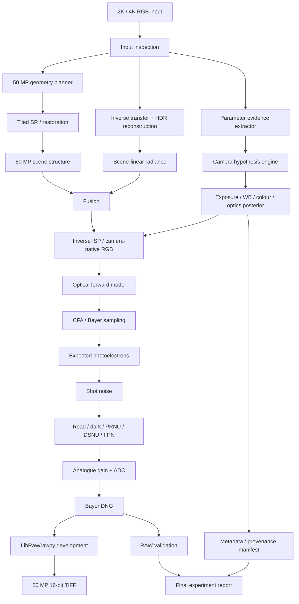

# PRD v5 — Final Single-Colab Synthetic 50 MP RAW Camera Reconstruction

## Executive summary

This PRD defines the final experiment: **one Google Colab notebook, designed for Claude Code to implement, that accepts the supplied image and its 2K and 4K variants and constructs one internally consistent hypothetical 50 MP physical-camera capture.** It must output both a **50 MP developed 16-bit TIFF** and a **real Bayer-mosaic DNG** whose pixel values, metadata, colour matrices, noise description, exposure parameters and sensor model all describe the same synthetic exposure.

The notebook is not a JPEG-to-DNG converter and must not claim to “recover” the camera data that produced the source. RGB-to-RAW is fundamentally ill-posed because demosaicing, colour conversion, tone mapping, clipping and quantisation discard information; Brooks et al.'s unprocessing work, RAW-Diffusion, RAW-Flow, the NTIRE RAW-reconstruction challenge and the newer SpiralDiff work all treat RGB→RAW as inverse rendering or conditional reconstruction rather than exact recovery. citeturn147249academia0turn871029search2turn871029search6turn871029academia7turn871029search0

The central product rule is therefore:

> **Every plausible camera parameter must be explicitly handled, but every parameter must also disclose whether it came from visible image evidence, a camera-profile constraint, a probability distribution, a user setting, or pure fabrication.**

The final pipeline should be hybrid rather than one monolithic model:

```text
2K / 4K rendered RGB
        ↓
input analysis + source uncertainty
        ↓
50 MP structure reconstruction
        ↓
scene-linear / HDR reconstruction
        ↓
camera-space inverse ISP hypothesis
        ↓
exposure + optics hypothesis
        ↓
clean sensor irradiance
        ↓
CFA / Bayer sampling
        ↓
photoelectrons
        ↓
shot + read + dark + fixed-pattern effects
        ↓
analogue gain + ADC + black pedestal
        ↓
synthetic Bayer DNG
        ↓
conventional RAW development
        ↓
50 MP 16-bit TIFF
```

The previous PRD already established several important ideas that this version retains: DNG rather than fake proprietary ARW, an explicit sensor model, tiled inference, field-level provenance, conventional RAW-development validation and a “Read this first” disclosure block. fileciteturn0file0

This final pass materially strengthens that design in five ways. First, it integrates **2025–2026 RGB→RAW research**, especially RAW-Flow, SpiralDiff and the NTIRE reverse-ISP benchmark. Second, it replaces vague “predict every metadata field” language with an explicit **parameter registry and per-field estimation/fabrication mode**. Third, it requires **coherence constraints** between metadata and generated pixels: if ISO, gain, full well, read noise or colour matrices change, the synthetic RAW values must change consistently. Fourth, it adds **probabilistic camera-hypothesis sampling**, because many fields cannot be uniquely inferred from one RGB image. Fifth, it adds a strict **2K-versus-4K experimental design** so the notebook can quantify how much final 50 MP information is source-supported versus model-generated.

The primary output container must be **DNG**, not a fabricated `.ARW`. Adobe publicly specifies DNG, describes it as a non-proprietary RAW container, and distributes an SDK capable of reading and writing DNG; the current DNG SDK release listed by Adobe is 1.7.1 Build 2768 dated 13 October 2026. citeturn871029search3

A selectable **Sony α1 II-like** profile is the recommended default physical reference because Sony specifies a 35.9 × 24.0 mm full-frame sensor, approximately 50.1 MP effective resolution and a native 8640 × 5760 still-image size. citeturn393893search0turn393893search1 It must still be labelled synthetic unless the user provides actual calibration files for that camera.



## Scientific basis and model choices

### Research that should directly influence the notebook

Brooks et al.'s *Unprocessing Images for Learned Raw Denoising* remains the correct analytic baseline because it explicitly reverses gain, white balance, colour correction, tone mapping and display encoding to synthesise plausible sensor measurements from processed images. citeturn147249academia0 CycleISP extends the same idea with learned forward and reverse camera-processing branches and explicitly separates clean RAW synthesis from subsequent noise injection. citeturn869170search4

RAW-Diffusion is the most directly applicable generative reference from Sony Research. It generates camera-specific RAW guided by RGB and reports that camera adaptation can work with relatively few camera-specific images; its official implementation is published under Apache-2.0. citeturn871029search2turn308834search2

RAW-Flow, published at AAAI 2026, advances RGB→RAW reconstruction using deterministic latent flow matching and explicitly motivates the method through the colour and detail ambiguity of quantised RGB inversion. citeturn871029search6 SpiralDiff, published at CVPR 2026, adds two ideas especially relevant here: **signal-dependent reconstruction weighting** and lightweight camera-specific adaptation through CamLoRA. Its official repository is Apache-2.0. citeturn871029search0turn871029academia8turn308834search0

The NTIRE 2025 RAW Reconstruction from RGB challenge is also important because it establishes that reverse ISP without source metadata is now a dedicated benchmark problem rather than a niche thought experiment; more than 150 participants contributed methods to the challenge. citeturn871029academia7

For sensor noise, the notebook should follow physics rather than image-space grain. The ELD noise-formation work explicitly models CMOS sensor electronics and decomposes multiple physical noise sources instead of using only Gaussian noise. citeturn871029academia9

For super-resolution, HAT is the preferred fidelity-oriented model: it combines windowed self-attention, channel attention and overlapping cross-window attention and has an official open implementation. citeturn147249academia1turn869170search1 Real-ESRGAN is the practical fallback because its official inference supports tiling, half precision and arbitrary final scale through post-resize; the upstream project uses BSD-3-Clause. citeturn869170search2turn308834search1

Single-image HDR reconstruction should be treated as a separate inverse-tone-mapping problem rather than as “16-bit conversion”. The AIM 2025 inverse-tone-mapping challenge specifically benchmarked single-LDR-to-HDR reconstruction, with evaluation focused on perceptual and numerical HDR fidelity. citeturn147249academia2

### Final model stack

| Stage | Primary | Alternative | Why |
|---|---|---|---|
| Spatial reconstruction | HAT / Real-HAT | Real-ESRGAN | Fidelity first; both support practical tiled inference. citeturn147249academia1turn869170search2 |
| HDR / inverse tone | analytic inverse tone + optional learned ITM | experimental 2025 ITM model | Keeps non-clipped regions anchored; learned generation only where information is missing. citeturn147249academia2 |
| RGB→RAW | hybrid analytic + RAW-Diffusion/RAW-Flow concept | analytic unprocessing only | Learned component handles ambiguity; analytic branch maintains interpretability. citeturn147249academia0turn871029search2turn871029search6 |
| Camera adaptation | camera-profile conditioning | CamLoRA-style adaptation | SpiralDiff shows explicit camera-aware adaptation is beneficial in multi-camera RGB→RAW. citeturn871029search0 |
| Sensor noise | physical electron-domain model | learned residual noise | Explicit metadata/pixel consistency is more important than photographic “grain”. citeturn871029academia9 |
| RAW container | Adobe DNG | none | Public specification and SDK; avoid proprietary ARW fabrication. citeturn871029search3 |
| RAW development | LibRaw/rawpy | Adobe DNG SDK validation | Independent round-trip proves the RAW is actually interpretable. |

The notebook should support three inverse-ISP modes:

```python
INVERSE_ISP_MODE = "HYBRID"
# "ANALYTIC"
# "LEARNED_RGB2RAW"
# "HYBRID"
```

`ANALYTIC` follows explicit unprocessing. `LEARNED_RGB2RAW` uses an available compatible RGB→RAW model. `HYBRID` should be the default: low-frequency exposure, colour and tone remain anchored to analytic inversion while learned reconstruction contributes camera-space residuals, clipping recovery and ambiguous fine structure. This structure is a design recommendation derived from the complementary strengths of unprocessing and recent generative RGB→RAW research. citeturn147249academia0turn871029search2turn871029search6

### Model/repository feasibility

| Repository | Role | Open licence | Colab feasibility | Final disposition |
|---|---|---:|---:|---|
| SonyResearch/RAW-Diffusion | RGB→RAW generative prior | Apache-2.0 | Medium | **Use experimentally**. citeturn308834search2 |
| Chuancy-TJU/SpiralDiff | 2026 camera-adaptive RGB→RAW | Apache-2.0 | Medium/high | **Research reference; integrate only if checkpoint/runtime is stable**. citeturn308834search0 |
| RAW-Flow | deterministic latent flow RGB→RAW | paper/code available | Medium | **Strong experimental backend**. citeturn871029search6 |
| XPixelGroup/HAT | structure-preserving SR | Apache-2.0 repository | Medium | **Primary SR**. citeturn869170search1 |
| Real-ESRGAN | practical real-world SR | BSD-3-Clause | High | **Fallback / baseline**. citeturn308834search1turn869170search2 |
| CycleISP | learned forward/reverse ISP | public repository | Medium, older stack | **Reference/comparison only**. citeturn869170search4 |
| Adobe DNG SDK | standards-compliant RAW writing | Adobe DNG SDK terms | CPU-friendly | **Reference writer/conformance path**. citeturn871029search3 |

## Complete parameter synthesis contract

Claude Code must implement a single central registry. **No field may be hidden as a magic constant.** Each value carries value, units, uncertainty, method, provenance and validation rule.

```python
@dataclass
class CameraField:
    name: str
    value: Any
    units: str | None

    mode: Literal[
        "AUTO",
        "ESTIMATE",
        "FABRICATE",
        "USER"
    ]

    provenance: Literal[
        "OBSERVED",
        "ESTIMATED",
        "DERIVED",
        "PRIOR_SAMPLED",
        "SYNTHETIC",
        "USER_SET",
        "UNSPECIFIED"
    ]

    confidence: float | None
    posterior: dict | None
    method: str
    validation: str
```

Every field must expose an **estimate/fabricate toggle** where meaningful:

```python
FIELD_MODE["iso"] = "ESTIMATE"
FIELD_MODE["aperture"] = "ESTIMATE"
FIELD_MODE["sensor_temperature"] = "FABRICATE"
FIELD_MODE["gps"] = "USER"
FIELD_MODE["prnu"] = "FABRICATE"
FIELD_MODE["color_matrix"] = "ESTIMATE"
```

The notebook should never silently fabricate identity-sensitive metadata such as a real Sony serial, GPS position or timestamp.

### Sensor and ADC parameters

| Parameter | Precise meaning | From RGB? | Default method | Prior / range | Validation |
|---|---|---|---|---|---|
| Sensor width/height px | Bayer-active raster | No; configured | target geometry | native profile or aspect-preserving 50 MP | exact dimensions |
| Sensor physical size | silicon imaging area | Not identifiable | camera-profile prior | full-frame profile default: 35.9×24.0 mm for α1 II-like citeturn393893search0 | geometry consistency |
| Pixel pitch | physical sensor pitch | Derived | sensor mm ÷ pixels | profile-derived | arithmetic |
| CFA pattern | R/G/B photosite arrangement | Not inferable from rendered RGB | profile/user | RGGB default; BGGR/GRBG/GBRG alternatives | DNG parse and plane test |
| CFA phase/origin | location of CFA tile origin | No | profile | 2×2 phase | round-trip |
| ADC bit depth | converter precision | No | camera profile | 12–16 synthetic; 14 default Sony-like | code range |
| Black level | DN corresponding to zero light | No | profile/prior | per-plane sampled constrained positive | dark-stat test |
| White level | saturation code | No | ADC/profile | `<2^bits` | saturation test |
| Full-well capacity | maximum electrons before saturation | No | sensor prior | log-normal camera-family prior | photon-transfer consistency |
| Conversion gain | electrons per digital code | No | derived/prior | positive | PTC consistency |
| Analogue gain | pre-ADC signal amplification | Partially tied to ISO, not observable uniquely | exposure hypothesis | piecewise monotonic | ISO/noise consistency |
| Digital gain | post-ADC scaling | Not identifiable | profile | ≈1 by default | pipeline trace |
| Sensor non-linearity | pre-ADC deviation from linearity | No | optional LUT | identity by default | flat-field sweep |
| Quantisation | ADC mapping | No | uniform | selected bits | code histogram |
| Clipping behaviour | saturation handling | No | hard clip default | at white level | saturated pixels |
| Dual conversion gain | multiple gain regimes | No | optional fabricated model | profile-dependent | ISO discontinuity test |
| Rolling/global shutter | sensor readout style | Weak cues only | prior/user | mechanical/electronic synthetic modes | metadata consistency |
| Sensor temperature | sensor thermal state | No | fabricated only | e.g. −10–60 °C experimental prior | no claim of truth |

A Sony α1 II-like preset may use Sony's published full-frame geometry and 8640 × 5760 native resolution, but any unmeasured electronics parameters remain synthetic. citeturn393893search0

### Noise and photosite parameters

The clean sensor value should first be represented as **expected photoelectrons**. Noise is then drawn in sensor space; it should not be pasted onto RGB after rendering.

For expected electrons \(e\),

\[
e_{\text{shot}}\sim \mathrm{Poisson}(e)
\]

followed by read/electronic terms, fixed-pattern terms and conversion to digital codes. The ELD literature supports explicit modelling of multiple CMOS-electronic noise sources rather than only additive white Gaussian image noise. citeturn871029academia9

| Parameter | RGB-estimable? | Synthesis method | Prior | Validation |
|---|---|---|---|---|
| Shot noise | No actual noise can be recovered | Poisson electron draw | physically signal-dependent | variance vs mean |
| Read noise | At most weakly inferred | Gaussian / heavy-tail electronic prior | positive e⁻ RMS, profile conditioned | dark histogram |
| PRNU | No | multiplicative pixel-response map | zero-mean small sigma | flat-field spatial statistics |
| DSNU | No | additive pixel dark-offset map | small DN/e⁻ distribution | dark-frame emulation |
| Row FPN | No | row-correlated offset field | low-amplitude Gaussian/1/f | row PSD |
| Column FPN | No | column-correlated offset | low amplitude | column PSD |
| Dark current | No | Poisson thermal electrons × exposure | exposure/temp conditioned | long-exposure scaling |
| Hot pixels | No | sparse defect process | low-rate Bernoulli | defect count |
| Dead pixels | No | sparse zero-response process | lower-rate Bernoulli | defect count |
| Blooming | Usually irrelevant for modern still model | optional saturated-charge spread | disabled default | saturated-source test |
| Quantisation noise | Derived | ADC rounding | determined by bits/gain | code histogram |
| NoiseProfile | Derived | calculate from actual signal/read model | no independent guessing | compare DNG tags to simulation |

The key rule is that DNG noise metadata is generated **from the same sensor parameters used to create the pixel values**, not separately.

### Colour, illumination and RAW interpretation

| Parameter | Can RGB estimate it? | Method | Prior / constraint | Validation |
|---|---|---|---|---|
| Scene-linear RGB | Partly | inverse transfer + inverse tone/HDR reconstruction | non-negative float | forward-render consistency |
| Camera-native RGB | Ambiguous | analytic inverse colour transform + learned residual | matrix-conditioned | re-render ΔE / LPIPS |
| Sensor spectral sensitivity | **No unique inversion** | low-dimensional profile hypothesis only | smooth positive curves if experimental | spectral benchmark only |
| ColorMatrix1/2 | Approximate | constrained camera-profile solve or profile prior | invertible 3×3 | DNG render |
| ForwardMatrix1/2 | Derived/profile | camera→XYZ calibration transform | DNG-constrained | round trip |
| CameraCalibration1/2 | Optional | identity/default unless calibrated | close to identity | profile validity |
| CalibrationIlluminant1/2 | Estimate/prior | profile illuminants | typically warm/daylight pair | WB interpolation |
| AnalogBalance | Not uniquely inferable | profile prior | near-unity positive vector | DNG parser |
| AsShotNeutral | Yes, uncertain | colour-constancy / WB estimator | positive, G-normalised | rendered WB |
| Colour temperature | Approximate | illuminant estimator | **2500–9900 K** allowed by α1 II official range for Sony-like preset. citeturn393893search0 | held-out EXIF |
| Tint | Approximate | residual chromaticity fit | bounded | neutral-patch test |
| BaselineExposure | Derived | chosen RAW headroom/development mapping | plausible EV offset | developer response |
| BaselineNoise | Derived/profile | noise-model relative level | positive | metadata |
| BaselineSharpness | Configured | render profile | positive | metadata |

**Spectral sensitivity must never be labelled recovered.** A rendered three-channel RGB value cannot uniquely determine the original wavelength distribution because many spectra can produce the same colour coordinates. This is an identifiability limitation, not a model-quality problem.

### Exposure, lens and optical fields

ISO, aperture and shutter are not independently identifiable from final image brightness after an unknown ISP. They should therefore be estimated jointly as a **posterior over plausible capture hypotheses**, not as three independent regressions.

Use:

\[
EV_{100}=\log_2\left(\frac{N^2}{t}\right)
\]

and let ISO, estimated scene luminance, blur, depth-of-field cues and target sensor noise constrain candidate triples.

| Parameter | Estimation method | Default range | Confidence |
|---|---|---:|---|
| ISO | noise/exposure posterior | 50–102400 synthetic search space | Low–medium |
| Shutter time | motion-blur + exposure posterior | 1/32000 s–30 s | Low |
| Aperture | defocus/DOF + exposure posterior | f/1–f/22 | Low |
| Exposure compensation | rendered brightness vs metering hypothesis | −5…+5 EV | Low |
| Focal length | image FOV/intrinsics + sensor size | profile-conditioned | Medium–low |
| 35 mm equivalent | derived | exact after focal/sensor hypothesis | Medium |
| Focus distance | monocular depth/defocus | 0.2 m–∞ | Low |
| Lens model | candidate or synthetic virtual lens | blank by default | Very low |
| Lens make | profile/user | synthetic label | None |
| Radial distortion | line geometry fit | near zero to modest | Medium in architectural scenes |
| Tangential distortion | geometry fit | near zero | Low |
| Vignetting | radial low-frequency fit after scene-mask | 0–2 EV edge fall-off | Low |
| Lateral CA | channel displacement around edges | subpixel–few px at final scale | Medium |
| Longitudinal CA | depth-dependent coloured blur | optional fabricated | Very low |
| PSF | edge spread estimation | spatially varying optional | Medium |
| Diffraction | derived from aperture/wavelength | optical calculation | depends on aperture uncertainty |
| Lens MTF | approximate from PSF | inferred, not manufacturer MTF | High uncertainty |
| Motion blur | PSF/kernel estimate | local/global | Medium |
| Stabilisation | cannot reliably infer | unspecified/fabricated | None |

Optics are applied **before Bayer sampling**, because a physical lens modifies the light field before the sensor measures it.

### EXIF, DNG and unobservable metadata

The notebook must populate every field in its registry even when the value is `UNSPECIFIED`.

| Field | Default |
|---|---|
| Make | `Synthetic` |
| Model | selected synthetic profile |
| UniqueCameraModel | explicit synthetic identifier |
| ImageDescription | mandatory synthetic-capture disclosure |
| Software | notebook version + git hash |
| DNGVersion | writer-controlled |
| DNGBackwardVersion | writer-controlled |
| PhotometricInterpretation | CFA |
| SamplesPerPixel | 1 |
| BitsPerSample | sensor container/ADC representation |
| Compression | uncompressed or lossless DNG |
| CFARepeatPatternDim | 2×2 |
| CFAPattern | selected Bayer layout |
| CFAPlaneColor | derived |
| CFALayout | derived |
| ActiveArea | generated raster |
| DefaultCropOrigin | geometry policy |
| DefaultCropSize | image-supported crop |
| BlackLevelRepeatDim | CFA-based |
| BlackLevel | simulator values |
| WhiteLevel | simulator saturation |
| AsShotNeutral | estimated WB hypothesis |
| ColorMatrix1/2 | camera hypothesis |
| ForwardMatrix1/2 | derived/profile |
| CalibrationIlluminant1/2 | profile |
| AnalogBalance | profile |
| NoiseProfile | sensor model |
| BaselineExposure | development mapping |
| ISO | exposure hypothesis |
| ExposureTime | exposure hypothesis |
| FNumber | exposure hypothesis |
| FocalLength | optics hypothesis |
| LensModel | blank or synthetic label |
| MeteringMode | unspecified unless fabricated |
| Flash | estimate only with strong evidence |
| FocusMode | unspecified/fabricated |
| DriveMode | unspecified/fabricated |
| Timestamp | blank unless user supplies or fabrication enabled |
| GPS | **blank unless user supplies it** |
| Camera serial | blank |
| Lens serial | blank |
| Battery | blank unless experimental fabrication enabled |
| Sensor temperature | blank unless experimental fabrication enabled |
| Shutter count | blank |
| Orientation | observed/derived |
| Source SHA-256 | measured |
| Random seed | measured/configured |
| Checkpoint hashes | measured |
| Synthetic-capture flag | always true |

The notebook may expose:

```python
FABRICATE_UNOBSERVABLE_METADATA = False
```

When enabled, it may populate temperature, metering mode, focus mode, timestamp, battery and similar fields for stress-testing metadata handling, but all such values remain `SYNTHETIC`. GPS and genuine-looking body serials should remain user-only.

## Colab implementation architecture

### Geometry modes

The notebook must support:

```python
GEOMETRY_MODE = "PRESERVE_SOURCE_ASPECT_50MP"
# "SONY_A1II_NATIVE"
```

`SONY_A1II_NATIVE` produces 8640 × 5760, Sony's published approximately 50 MP geometry. citeturn393893search0

`PRESERVE_SOURCE_ASPECT_50MP` avoids the earlier failure where a wide image required large invented top/bottom regions. For source width \(w\), height \(h\), aspect \(a=w/h\), target megapixels \(M\):

\[
H=\sqrt{\frac{M\cdot10^6}{a}},
\qquad
W=aH
\]

rounded to even Bayer-compatible dimensions.

For native 3:2 mode:

```python
NATIVE_FIT_POLICY = "LETTERBOX_SENSOR_MARGIN"
# "OUTPAINT_VERTICAL"
# "CROP_HORIZONTAL"
```

The default should be `LETTERBOX_SENSOR_MARGIN` or crop metadata rather than silently inventing 30%+ of the sensor scene.

### 2K versus 4K experimental protocol

The 2K and 4K source variants must run through **identical camera and random-seed hypotheses**.

```text
2K input ─┐
          ├── same camera hypothesis ── 50 MP RAW A
4K input ─┘                            50 MP RAW B
```

Compare them at:

- source-aligned full-resolution patches;
- frequency bands;
- edge MTF;
- fine-texture patches;
- model-generated-detail masks;
- RAW-domain values before and after sensor noise;
- downsample-to-source reconstruction.

Do not compare them only after large downsampling, because that hides fine-detail differences.

### Memory model

Approximate raw storage sizes for 50 MP:

| Representation | Approximate payload |
|---|---:|
| Bayer `uint16`, 1 channel | ~100 MB |
| RGB `uint16`, 3 channels | ~300 MB |
| RGB `float32`, 3 channels | ~600 MB |
| Two float32 RGB work buffers | ~1.2 GB |
| Neural feature activations | potentially many GB |

Whole-frame neural inference is therefore prohibited.

Recommended defaults:

```python
SR_TILE = 512
SR_OVERLAP = 64

RAW_TILE = 1024
RAW_OVERLAP = 128

MODEL_DTYPE = "bf16_if_supported_else_fp16"
CPU_ACCUMULATION = "numpy.memmap"
GLOBAL_GUIDANCE_SCALE = 0.125
```

HAT and Real-ESRGAN both provide practical precedents for tiled large-image inference. citeturn869170search2turn147249academia1

Use an overlap window such as Hann/cosine weighting:

\[
I(x,y)
=
\frac{\sum_i w_i(x,y)I_i(x,y)}
{\sum_i w_i(x,y)+\epsilon}
\]

to eliminate hard tile seams.

### Runtime requirements

Google explicitly states that Colab GPU availability and resource limits vary over time and are not guaranteed. Free notebooks generally run for no more than 12 hours, while Pro+ can support continuous execution up to 24 hours when sufficient compute units are available. citeturn258776search0turn258776search1

The notebook must inspect hardware dynamically and never assume an A100.

Planning envelopes:

| Hardware | Recommended configuration | Target peak VRAM | Estimated inference envelope* |
|---|---|---:|---:|
| T4 / low-tier GPU | Real-ESRGAN + analytic inverse ISP | <14 GB | ~15–45 min |
| L4 | HAT + hybrid inverse ISP | <20 GB | ~8–25 min |
| A100 40 GB | full pipeline + learned RGB→RAW | <32 GB | ~4–15 min |
| A100 80 GB / H100 | larger tiles / experimental diffusion | <55 GB | ~3–10 min |

\*Engineering estimates to be benchmarked by the notebook, not guaranteed performance claims.

### Notebook cell contract

| Cell group | Responsibility | Output |
|---|---|---|
| Read this first | synthetic-data disclaimer; active/no-op/skipped modules | visible report |
| Hardware inspector | GPU, VRAM, RAM, CUDA, disk | `runtime.json` |
| Reproducibility | global seeds, checkpoint hashes | `repro.json` |
| Input loader | 2K/4K source, ICC, EXIF, hashes | `source.json` |
| Source diagnostics | histograms, clipping, compression, noise, gradients | diagnostic PNGs |
| Geometry planner | exact 50 MP geometry | `geometry.json` |
| Field registry | instantiate every parameter | `fields_initial.json` |
| Camera selector | generic/α1 II-like/custom | `camera_profile.json` |
| Structure reconstruction | tiled HAT/Real-ESRGAN/Lanczos | HR RGB |
| HDR reconstruction | float scene-linear radiance + uncertainty masks | EXR/NPY |
| Exposure solver | posterior over ISO/shutter/aperture | `exposure.json` |
| Colour solver | WB, matrices, illuminants | `colour.json` |
| Optics solver | FOV, PSF, vignetting, distortion, CA | `optics.json` |
| Inverse ISP | camera-native clean linear RGB | NPY/memmap |
| CFA stage | one-value-per-photosite Bayer mosaic | NPY/memmap |
| Sensor stage | electrons + stochastic sensor effects | NPY/memmap |
| ADC | black pedestal, gain, clipping, DN | `uint16` memmap |
| DNG writer | standards-compliant synthetic RAW | `.dng` |
| Round-trip | reopen through rawpy/LibRaw | previews |
| TIFF development | conventional 16-bit development | `.tif` |
| Validation | all quality/physics/editability metrics | HTML/JSON |
| 2K/4K comparison | source-resolution experiment | comparison report |
| Export | manifest/config/hashes/results | final folder |

### Required configuration panel

```python
TARGET_CAMERA = "SONY_A1II_LIKE"
GEOMETRY_MODE = "PRESERVE_SOURCE_ASPECT_50MP"

SR_BACKEND = "HAT"
INVERSE_ISP_MODE = "HYBRID"

ENABLE_HDR = True
ENABLE_LEARNED_RGB2RAW = True

CFA_PATTERN = "RGGB"
ADC_BITS = 14

ENABLE_SHOT_NOISE = True
ENABLE_READ_NOISE = True

ENABLE_PRNU = False
ENABLE_DSNU = False
ENABLE_ROW_FPN = False
ENABLE_COLUMN_FPN = False
ENABLE_DARK_CURRENT = False
ENABLE_HOT_PIXELS = False
ENABLE_DEAD_PIXELS = False

ENABLE_DISTORTION = False
ENABLE_VIGNETTING = False
ENABLE_CHROMATIC_ABERRATION = False
ENABLE_DIFFRACTION = False

FABRICATE_UNOBSERVABLE_METADATA = False

WRITE_DNG = True
WRITE_TIFF16 = True
WRITE_MANIFEST = True

SEED = 42
```

Every boolean must appear in the final report as **enabled**, **disabled**, **skipped because dependency unavailable**, or **enabled but no-op**. No silent no-ops.

## Validation and acceptance criteria

The experiment is successful only if it produces a DNG that behaves internally like the camera hypothesis it claims to represent. A pretty TIFF alone is not enough.

### Validation against real RAW

Build a separate benchmark from genuine RAW images:

```text
real high-resolution RAW
        ↓
trusted RAW development
        ↓
controlled tone map / resize / JPEG or PNG
        ↓
2K and 4K rendered inputs
        ↓
notebook reconstruction
        ↓
compare predicted RAW with original RAW
```

MIT-Adobe FiveK provides 5,000 RAW DNG photographs and expert retouchings. citeturn393893search2 RAISE provides 8,156 camera-native high-resolution RAW images from three cameras and explicitly includes flat-field imagery useful for PRNU-oriented analysis. citeturn393893search3 SID contains real Sony α7S II RAW short/long exposure imagery and therefore contributes genuine Sony full-frame RAW data, although it is a low-light dataset rather than a 50 MP dataset. citeturn393893search4turn393893search9 Zurich RAW-to-RGB contains more than 20,000 scenes with RAW imagery from a Huawei P20 Sony IMX380 sensor and paired professional DSLR capture, so it is useful for ISP learning but not a Sony full-frame camera match. citeturn393893search5turn393893search8

Dataset licences must be checked before redistribution or commercial use; do not assume that “publicly downloadable” means unrestricted commercial training.

### Metric groups

**Spatial truth**

- PSNR / SSIM on held-out synthetic degradation pairs.
- LPIPS on aligned patches.
- edge-location error.
- MTF50 / MTF10.
- texture-spectrum deviation.
- comparison with Lanczos and HAT baselines.
- hallucinated-detail mask overlap with unsupported regions.

**Colour / HDR**

- ΔE2000 after trusted RAW development.
- white-balance angular error.
- camera-matrix forward-render error.
- PU21-PSNR or another HDR-appropriate metric on HDR benchmarks; the 2025 AIM challenge uses dedicated HDR numerical/perceptual evaluation rather than ordinary 8-bit metrics. citeturn147249academia2
- highlight-reconstruction error where ground truth exists.
- shadow-radiance error.

**Sensor statistics**

For flat regions:

\[
\operatorname{Var}(DN)
\approx
a\operatorname{Mean}(DN)+b
\]

with measured slope/intercept compared against the synthetic sensor's shot/read-noise parameters.

Test:

- mean–variance photon-transfer curve;
- dark histogram;
- hot/dead pixel rate;
- spatial PSD for row/column FPN;
- PRNU correlation;
- saturation distribution;
- black-level stability;
- quantisation-code distribution.

**RAW editability**

Develop the synthetic DNG with:

```text
Exposure: −3, −2, 0, +2, +3 EV
WB: cool, neutral, warm
Highlights: low/high recovery
Shadows: low/high lift
Different demosaic methods
```

The image should react continuously and plausibly rather than reveal that its apparent RAW latitude was merely baked into an RGB image.

**DNG validity**

The DNG must:

- reopen in rawpy/LibRaw;
- expose one CFA sample per photosite;
- report expected Bayer pattern;
- report expected black/white levels;
- produce the same crop and orientation metadata recorded in the registry;
- preserve all relevant synthetic tags;
- develop without corruption;
- agree with the manifest.

### Acceptance gates

| Gate | MVP threshold |
|---|---|
| DNG parse | 100% generated files reopen with LibRaw/rawpy |
| CFA integrity | exact selected CFA phase and dimensions |
| Metadata coherence | 100% simulator parameters match corresponding DNG/manifest fields |
| Tile seams | no seam >1 DN-equivalent after overlap blending in clean RAW |
| 2K/4K comparison | full-resolution crop metrics produced, not only downsampled comparison |
| SR value | must report whether learned SR beats Lanczos on genuine held-out truth |
| HDR validity | no claim of recovered highlight truth in clipped source regions |
| Noise validity | mean–variance slope and read-noise intercept within configured tolerance on synthetic flat tests |
| Colour | ΔE metrics against ground truth where camera/profile pairs exist |
| Provenance | every field contains provenance + method |
| No silent no-op | zero enabled features may silently execute as identity |
| Output | DNG + 16-bit TIFF + JSON/HTML report + hashes |

A feature that cannot meet its validation target remains **experimental and disabled by default**.

## Implementation roadmap and Claude Code instructions

### MVP

Build this first:

```text
RGB input
→ aspect-preserving 50 MP reconstruction
→ inverse display transfer
→ analytic scene-linear estimate
→ configurable camera colour matrix
→ WB hypothesis
→ Bayer mosaic
→ physical shot/read noise
→ ADC
→ DNG
→ LibRaw development
→ TIFF16
→ manifest + validation
```

MVP camera fields:

```text
geometry
CFA
ADC bits
black/white levels
colour matrices
AsShotNeutral
baseline exposure
ISO hypothesis
shutter hypothesis
aperture hypothesis
full well
conversion gain
shot noise
read noise
DNG NoiseProfile
crop
orientation
synthetic identity
```

No learned RGB→RAW model is required for MVP.

### Fidelity phase

Add:

- HAT tiled SR;
- explicit 2K/4K comparison;
- scene-linear HDR reconstruction;
- exposure posterior;
- colour-constancy model;
- camera-profile selector;
- full-resolution validation crops.

HAT should remain fidelity-first because the earlier experiment established that perceptually aggressive upscaling can create convincing but false detail; the PRD's metric suite must explicitly reveal this rather than reward texture energy alone. fileciteturn0file0

### Learned RAW phase

Add RAW-Diffusion / RAW-Flow / SpiralDiff-inspired modules in this order:

```text
analytic RAW baseline
        ↓
camera-aware learned residual
        ↓
confidence gating
        ↓
clean camera-space RAW expectation
```

RAW-Diffusion's official repository and SpiralDiff's 2026 work show that camera-specific guidance/adaptation is a viable direction, but the final stochastic sensor noise must remain outside the learned semantic reconstruction layer. citeturn871029search2turn871029search0

### Full sensor phase

Enable experimental:

```text
PRNU
DSNU
row FPN
column FPN
dark current
hot/dead pixels
sensor non-linearity
dual conversion gain
temperature-conditioned noise
```

These must be profile priors or explicit fabricated hypotheses unless actual calibration data exists.

### Full optics phase

Enable:

```text
radial distortion
tangential distortion
vignetting
lateral chromatic aberration
axial chromatic aberration
spatial PSF
diffraction
defocus
motion blur
```

Optics are disabled by default unless their inferred coefficients are materially non-zero.

### Final metadata phase

Populate the complete registry, but preserve epistemic honesty:

```text
estimate what can plausibly be estimated,
derive what follows mathematically,
sample what needs a camera hypothesis,
leave unknowable identity/location fields empty,
and label all synthetic values explicitly.
```

### Claude Code implementation contract

Claude Code should organise the notebook around composable classes even though the deliverable is one `.ipynb`:

```python
InputInspector
GeometryPlanner
FieldRegistry
CameraProfile
StructureReconstructor
HDRReconstructor
ExposureEstimator
ColourEstimator
OpticsEstimator
InverseISP
SensorModel
NoiseModel
ADCSimulator
DNGWriter
RawDeveloper
Validator
ExperimentReporter
```

The main execution path must remain readable:

```python
experiment = SyntheticCaptureExperiment(config)

experiment.inspect_inputs()
experiment.plan_geometry()
experiment.build_camera_hypothesis()

experiment.reconstruct_structure()
experiment.reconstruct_radiance()
experiment.invert_isp()

experiment.apply_optics()
experiment.sample_cfa()
experiment.simulate_sensor()
experiment.quantise_adc()

experiment.write_dng()
experiment.roundtrip_raw()
experiment.develop_tiff16()

experiment.validate()
experiment.compare_2k_4k()
experiment.export_report()
```

No stage may mutate another stage's hidden global state.

The final bundle:

```text
outputs/
├── synthetic_50mp.dng
├── synthetic_50mp_16bit.tif
├── synthetic_50mp_preview.jpg
├── clean_bayer.npy
├── noisy_bayer.npy
├── field_registry.json
├── camera_hypothesis.json
├── experiment_config.json
├── validation.json
├── validation_report.html
├── 2k_vs_4k_report.html
├── generated_region_mask.png
├── uncertainty_map.png
├── source_hashes.json
└── checkpoint_hashes.json
```

## Changelog from the prior PRD

This final PRD keeps the prior document's strongest decisions—DNG instead of proprietary ARW, tiled 50 MP execution, explicit Bayer and electron-domain sensor modelling, field provenance, 2K/4K testing and independent RAW development—but tightens the experiment substantially. fileciteturn0file0

The biggest research upgrade is incorporation of the 2026 RGB→RAW literature. **RAW-Flow** adds deterministic latent flow matching for the inverse-ISP problem; **SpiralDiff** adds signal-dependent weighting and explicit camera adaptation; and the **NTIRE RAW Reconstruction challenge** provides a broader benchmark context for reverse ISP without metadata. citeturn871029search6turn871029search0turn871029academia7

The biggest architectural change is the new **Camera Hypothesis Engine**. Instead of pretending that ISO, aperture, shutter, sensor temperature, lens characteristics and other fields can all be directly predicted, the notebook now represents them as linked posterior distributions. One seeded draw produces a physically coherent hypothetical camera whose parameters control both the RAW values and its metadata.

The biggest sensor-model change is the requirement that **pixels and metadata derive from the same underlying parameters**. Full-well capacity, conversion gain, ISO gain, shot noise, read noise, black level, white level and DNG noise description can no longer be populated independently.

The biggest metadata change is that “fill every field” now means **every field is registered and explicitly resolved**, not that unknowable fields receive fabricated values by default. Timestamp, GPS, serial number, shutter count and similar identity/history fields remain blank unless deliberately enabled or user-supplied.

The biggest validation change is that the notebook is no longer allowed to validate its physics only against itself. It must support genuine RAW-derived benchmark pairs using resources such as FiveK, RAISE and SID, alongside synthetic flat/dark tests. citeturn393893search2turn393893search3turn393893search4

Finally, the product target is deliberately narrower than the earlier 100–200 MP/from-scratch-transformer path: **one excellent, inspectable 50 MP notebook first**. This substantially improves the chance that the experiment can be executed repeatedly in managed Colab, whose available GPU types and session limits are dynamic rather than guaranteed. citeturn258776search0